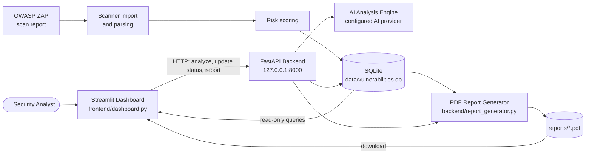

<div align="center">

# 🛡️ CyberShield AI

**AI-Powered Web Application Vulnerability Assessment & Security Intelligence Platform**

Import scanner findings, prioritise them by risk, get AI-assisted explanations, validate them manually and export a PDF VAPT report, all from one dashboard.


</div>

---

## 📑 Table of Contents

- [Overview](#-overview)
- [Key Features](#-key-features)
- [System Architecture](#-system-architecture)
- [Technology Stack](#-technology-stack)
- [Installation and Execution](#-installation-and-execution)
- [Screenshots](#-screenshots)
- [API Documentation](#-api-documentation)
- [Project Structure](#-project-structure)
- [Security and Responsible Usage](#-security-and-responsible-usage)
- [Roadmap](#-roadmap)
- [Contributing](#-contributing)
- [License](#-license)

---

## 🔎 Overview

**CyberShield AI** is a web application vulnerability assessment and security intelligence platform. It takes findings produced by the **OWASP ZAP** scanner, stores them in a local **SQLite** database, ranks them with a project-specific **risk score**, and presents them in an interactive **Streamlit** dashboard backed by a **FastAPI** service. For any finding, an analyst can request an **AI-generated analysis**, record a **manual validation decision**, and generate a **PDF VAPT report**.

### Why vulnerability assessment matters

Web applications are a primary attack surface. Flaws such as injection, broken access control and security misconfiguration are routinely found and exploited. Regular vulnerability assessment lets teams find these weaknesses before an attacker does, and a VAPT (Vulnerability Assessment and Penetration Testing) report gives developers and stakeholders a documented, actionable record of what was found.

### The problem it aims to solve

Automated scanners are good at finding issues and poor at explaining them. A single scan can produce a long list of findings with uneven severity, repeated entries and false positives. Analysts then spend time on three questions:

1. Which findings matter most?
2. What does this finding actually mean for this application?
3. Is it real, or a false positive?

### How AI assists the analyst

CyberShield AI uses an AI model to explain findings and suggest remediation, grounded in the evidence stored for each finding. The AI is **advisory only**: an AI analysis never confirms a finding on its own. The final decision (*Needs Validation*, *Confirmed* or *False Positive*) is always made by a human analyst and recorded with notes.

### Intended users

| User | How they benefit |
|---|---|
| 🎓 Cybersecurity students | A hands-on way to learn how scanner findings are triaged, validated and reported |
| 🧑‍💻 Security analysts | One workspace for prioritising, explaining and validating findings |
| 🧪 Penetration testers | Quick access to evidence, remediation guidance and a report to hand over |

---

## ✨ Key Features

### Implemented

| Feature | Description |
|---|---|
| 📊 **Interactive security dashboard** | Streamlit workspace with five pages: Security Overview, Vulnerability Explorer, AI Vulnerability Analysis, Manual Validation and PDF VAPT Report |
| 🗄️ **Local vulnerability database** | Findings are stored in SQLite (`data/vulnerabilities.db`, table `vulnerabilities`) and read by the dashboard |
| 🎯 **Risk-based prioritisation** | Every finding carries a `risk_score`. Findings are ordered by it, and the dashboard shows average risk, highest risk and the top five highest-risk findings |
| 📈 **Analytics** | KPI cards (total, average risk, highest risk, confirmed) plus severity distribution and validation-status charts built with Plotly |
| 🔍 **Search and filtering** | Filter by severity and validation status, and search across all finding fields |
| 📋 **Finding details** | Name, severity, affected URL, CWE ID (when mapped), description, evidence, recommended solution and risk score |
| 🤖 **AI-powered vulnerability analysis** | One-click analysis through the backend API. The response shows the analysis text plus the provider and model used |
| 🧑‍⚖️ **Manual validation** | Mark each finding as `Needs Validation`, `Confirmed` or `False Positive` and save analyst notes through the API |
| 📄 **PDF VAPT report** | The backend generates a PDF report from the stored findings. The dashboard lets you download it and lists previously generated reports from `reports/` |
| 🟢 **Backend health indicator** | The sidebar checks the API and shows an online/offline status |

### Planned

The following are **not implemented yet**. See the [Roadmap](#-roadmap).

- Advanced attack-path visualisation
- Additional scanner integrations
- Authentication and role-based access control
- Historical scan comparison
- Cloud deployment

---

## 🏗️ System Architecture



The dashboard reads findings straight from SQLite for fast display. Actions that change data or call external services (AI analysis, saving a validation decision, generating a report) go through the FastAPI backend.

### Component responsibilities

| Component | Responsibility |
|---|---|
| **Streamlit Dashboard** | User interface: charts, tables, filters, validation form, AI analysis view and report download |
| **FastAPI Backend** | HTTP API for AI analysis, status updates and report generation. Provides interactive Swagger documentation |
| **Scanner import and parsing** | Brings OWASP ZAP findings into the project's vulnerability format |
| **Risk scoring** | Assigns each finding a project-specific `risk_score` used for ranking |
| **AI Analysis Engine** | Sends a finding's details to the configured AI provider and returns an explanation with remediation guidance. It never auto-confirms a finding |
| **SQLite Database** | Persistent local store for findings, validation status and analyst notes |
| **PDF Report Generator** | Builds the VAPT report from stored findings (`generate_vapt_report`) and saves it under `reports/` |

---

## 🧰 Technology Stack

All libraries below are declared in [`requirements.txt`](requirements.txt).

| Layer | Technology | Purpose |
|---|---|---|
| Language | **Python** | Entire application |
| Backend API | **FastAPI**, **Uvicorn**, **Pydantic**, **python-multipart** | REST API, server, request validation and form/file handling |
| Dashboard | **Streamlit** | Web UI |
| Visualisation | **Plotly** | Interactive charts |
| Data handling | **Pandas**, **NumPy** | Loading and aggregating findings |
| Storage | **SQLite** | Local database |
| Reporting | **ReportLab** | PDF generation |
| HTTP client | **Requests** | Dashboard-to-API calls |
| Declared analytics dependencies | **scikit-learn**, **NetworkX** | Listed in `requirements.txt` for analysis and graph features |
| Scanner | **OWASP ZAP** | Source of vulnerability findings |
| AI | **AI provider API** | Vulnerability explanations (provider and model are reported in each analysis) |

---

## 🚀 Installation and Execution

> These steps are written for **Windows PowerShell**. You need **Python 3.9+** and **Git** installed.

### 1. Clone the repository

```powershell
git clone https://github.com/ambasthashreya08-commits/CyberShield-AI.git
cd CyberShield-AI
```

### 2. Create and activate a virtual environment

```powershell
python -m venv venv
.\venv\Scripts\Activate.ps1
```

If PowerShell blocks the activation script, allow it for the current session only:

```powershell
Set-ExecutionPolicy -Scope Process -ExecutionPolicy Bypass
.\venv\Scripts\Activate.ps1
```

### 3. Install dependencies

```powershell
python -m pip install --upgrade pip
pip install -r requirements.txt
```

### 4. Configure environment variables

Create a `.env` file in the project root for your AI provider credentials. **Never commit this file** and never paste real keys into the README, issues or screenshots.

```env
# Replace with the variable name(s) your AI module reads
<AI_API_KEY_VARIABLE>=your_api_key_here
```

### 5. Start the FastAPI backend (Terminal 1)

```powershell
uvicorn backend.main:app --reload --host 127.0.0.1 --port 8000
```

The dashboard expects the API at `http://127.0.0.1:8000`.

### 6. Start the Streamlit dashboard (Terminal 2)

Open a **new** PowerShell window, then:

```powershell
cd CyberShield-AI
.\venv\Scripts\Activate.ps1
streamlit run frontend/dashboard.py
```

### 7. Open the application

| What | URL |
|---|---|
| 🖥️ Dashboard | http://localhost:8501 |
| ⚙️ API root | http://127.0.0.1:8000 |
| 📘 Swagger UI | http://127.0.0.1:8000/docs |
| 📕 ReDoc | http://127.0.0.1:8000/redoc |

The sidebar shows **API CONNECTED** when the backend is reachable. If the database is empty, the dashboard asks you to import a scanner report first.

### Quick check: PDF report generation

With findings already in the database, this script generates a report from the command line:

```powershell
python test_report.py
```

It prints the report location and the number of findings included.

---

## 🖼️ Screenshots

Screenshots have not been added yet. Save your images with the file names below and the placeholders will be ready to use.

| Screen | Expected file |
|---|---|
| Main security dashboard | `docs/screenshots/dashboard.png` |
| Vulnerability explorer | `docs/screenshots/vulnerability-explorer.png` |
| AI vulnerability analysis | `docs/screenshots/ai-analysis.png` |
| Manual validation interface | `docs/screenshots/manual-validation.png` |
| PDF VAPT report | `docs/screenshots/pdf-report.png` |

<!--
After adding the images, replace the table above with:

### Main Security Dashboard


### Vulnerability Explorer


### AI Vulnerability Analysis


### Manual Validation


### PDF VAPT Report

-->

> ⚠️ Blur or remove any API keys, internal URLs or real client data before publishing screenshots.

---

## 📡 API Documentation

**Base URL:** `http://127.0.0.1:8000` · **Interactive docs (Swagger UI):** http://127.0.0.1:8000/docs

| Method | Endpoint | Purpose |
|---|---|---|
| `GET` | `/health` | Health check. The dashboard treats HTTP 200 as online |
| `POST` | `/vulnerabilities/{id}/analyze` | Generate an AI analysis for one finding |
| `PATCH` | `/vulnerabilities/{id}/status` | Save the analyst's validation decision and notes |
| `GET` | `/reports/pdf` | Generate and return the PDF VAPT report |

`{id}` is the finding's `id` value in the `vulnerabilities` table.

> The endpoints above are the ones the dashboard calls. Open **/docs** for the authoritative, auto-generated list, including any additional endpoints such as scan import.

### `GET /health`

```powershell
Invoke-RestMethod -Uri "http://127.0.0.1:8000/health"
```

Returns HTTP `200` when the API is running.

### `POST /vulnerabilities/{id}/analyze`

Requests an AI analysis. No request body is required. AI calls can take time, so allow up to 120 seconds.

```powershell
Invoke-RestMethod -Method Post -Uri "http://127.0.0.1:8000/vulnerabilities/1/analyze"
```

The dashboard reads the analysis from an `ai_analysis` object when present, otherwise from the response body itself. The fields it uses are:

```json
{
  "ai_analysis": {
    "analysis": "<explanation, impact and remediation text>",
    "provider": "<AI provider name>",
    "model": "<model name>",
    "automatically_confirmed": false
  }
}
```

`automatically_confirmed: false` means the analysis does not change the finding's status. Analyst validation is still required.

### `PATCH /vulnerabilities/{id}/status`

Saves a validation decision.

| Field | Type | Allowed values |
|---|---|---|
| `status` | string | `Needs Validation`, `Confirmed`, `False Positive` |
| `analyst_notes` | string | Free text explaining the evidence and decision |

```powershell
$body = @{
    status        = "Confirmed"
    analyst_notes = "Reproduced manually. Response contains the injected payload."
} | ConvertTo-Json

Invoke-RestMethod -Method Patch `
    -Uri "http://127.0.0.1:8000/vulnerabilities/1/status" `
    -ContentType "application/json" `
    -Body $body
```

Returns HTTP `200` on success.

### `GET /reports/pdf`

Generates the report and returns it as a PDF file.

```powershell
Invoke-WebRequest -Uri "http://127.0.0.1:8000/reports/pdf" -OutFile "CyberShield_VAPT_Report.pdf"
```

---

## 📂 Project Structure

```text
CyberShield-AI/
├── backend/
│   ├── database.py             # SQLite access (get_vulnerabilities)
│   ├── report_generator.py     # PDF VAPT report generation (generate_vapt_report)
│   └── ...                     # API, AI analysis, scanner import and risk-scoring modules
├── frontend/
│   └── dashboard.py            # Streamlit dashboard
├── docs/
│   └── screenshots/            # Add dashboard screenshots here
├── .gitignore
├── README.md
├── requirements.txt
├── test_ai.py                  # AI analysis test script
└── test_report.py              # PDF report generation test script
```

Created at runtime and **not meant to be committed**: `venv/`, `.env`, `data/vulnerabilities.db`, `reports/` and scan session files.

---

## 🔐 Security and Responsible Usage

- ✅ Use CyberShield AI **only on applications you own or have explicit written permission to test**. Scanning systems without authorisation may be illegal.
- 🤖 **AI-generated analysis is advisory.** It can be incomplete or wrong, so a human must verify it before acting on it or reporting it.
- 📏 The **risk score is a project-specific prioritisation indicator**. It is not an official CVSS score.
- 🚫 Do not upload sensitive production data, credentials or personal information to the tool or to any AI provider.
- 🔑 Keep API keys in `.env`, keep `.env` out of version control, and rotate any key that is ever exposed.
- 🧑‍⚖️ A finding is only **Confirmed** after a human analyst decides so.

---

## 🗺️ Roadmap

These are **planned** and not yet implemented.

- [ ] Advanced attack-path visualisation
- [ ] Additional scanner integrations
- [ ] Improved vulnerability intelligence
- [ ] Enhanced AI explanations
- [ ] Authentication and role-based access control
- [ ] Historical scan comparison
- [ ] Cloud deployment
- [ ] Automated test suite and CI

---

## 🤝 Contributing

Contributions, issues and suggestions are welcome.

1. Fork the repository.
2. Create a feature branch: `git checkout -b feature/your-feature`.
3. Make your changes and test them locally.
4. Commit with a clear message: `git commit -m "Add: short description"`.
5. Push the branch and open a pull request describing what changed and why.

Please never commit API keys, `.env` files, databases, generated reports or real scan data.

---

## 📜 License

No license has been added to this repository yet. Until one is added, all rights are reserved by the author.

---

<div align="center">

Built by [ambasthashreya08-commits](https://github.com/ambasthashreya08-commits) · For authorised security testing and education only.

</div>
